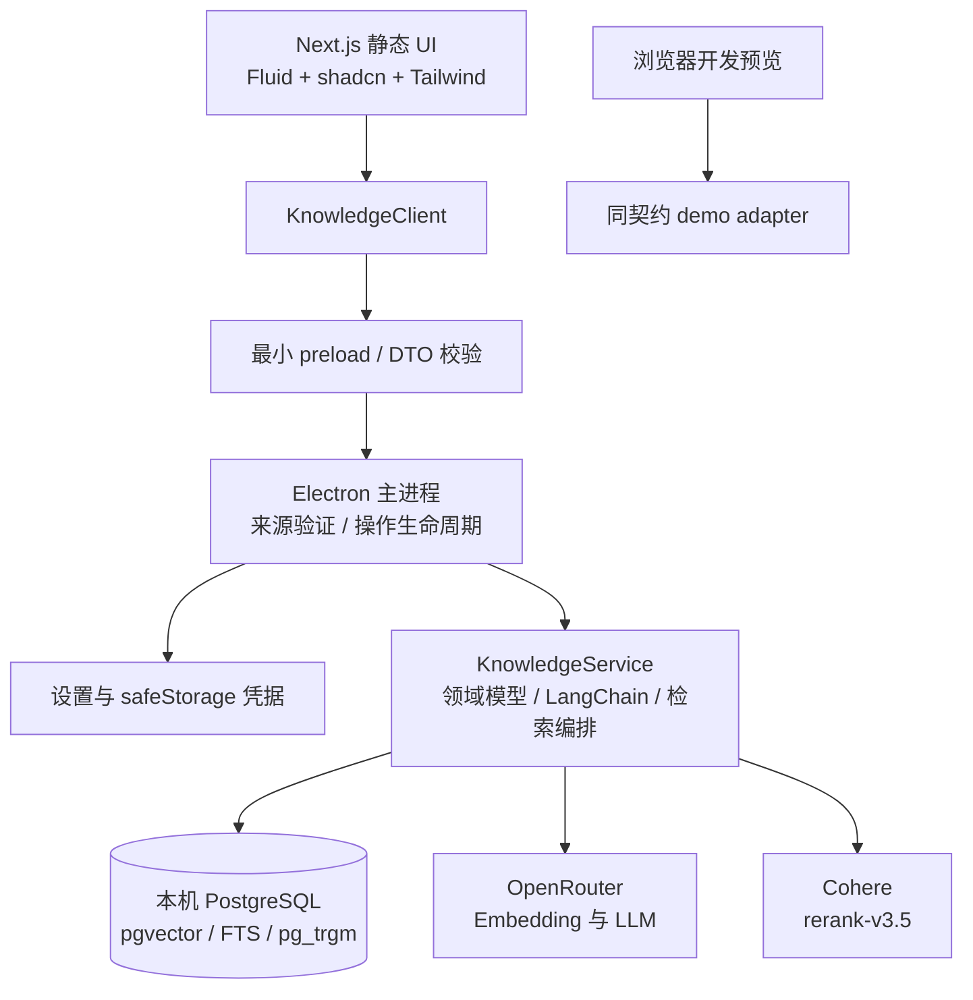
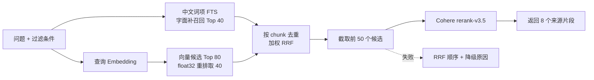

# 知屿 · 混合检索知识库架构设计 v1

日期：2026-10-16。状态：架构与交付约定，功能尚待实现。

本文是新需求的架构依据。现有 `docs/architecture.md` 记录初始化原型，其 SQLite 后续计划由本文的 PostgreSQL 方案替代。必读视觉规范是 [Designlang.md](../Designlang.md)，跨层接口见 [contracts-v1.md](contracts-v1.md)，开发方法见 [development-principles.md](development-principles.md)，三个 agent 的交接入口见 [agents/README.md](agents/README.md)。

## 1. 产品目标与本次范围

构建中文优先的个人知识库：资料在用户管理的 PostgreSQL 中保存，通过关键词和语义共同查找，再经 Cohere Rerank 3.5 排序，知识助手根据命中的片段作答并给出来源。保持现有产品名“知屿 / Zhiyu”。

| 已确定需求        | 架构决策                                                                         |
| ----------------- | -------------------------------------------------------------------------------- |
| 一套 UI、多端复用 | Electron + Next.js App Router + TypeScript；桌面使用静态导出                     |
| 主要 UI 库        | Fluid Functionalism 的 shadcn registry 组件，沿用 shadcn/Radix 与 Tailwind CSS 4 |
| 图标和品牌        | Lucide；原创极简毛笔 SVG，见 [brush.svg](../public/brand/brush.svg)              |
| 字体              | Geist / Geist Mono；中文使用霞鹜文楷屏幕阅读版                                   |
| 向量模型          | OpenRouter `openai/text-embedding-3-large`，默认 3072 维                         |
| 混合检索          | PostgreSQL 中文分词辅助 FTS + 字面匹配、pgvector cosine、加权 RRF                |
| 重排              | Cohere 独立 API，固定初始模型 `rerank-v3.5`                                      |
| 底层 AI 框架      | LangChain JavaScript/TypeScript，固定的两步 RAG                                  |
| 可配置功能        | LLM、embedding、分块、检索片段、Rerank、温度、数据库与凭据                       |
| 桌面稳定性        | 原生窗口标题栏优先；显式测试拖动与控件点击                                       |
| 实验阶段分发      | Windows x64、NSIS；暂不建设 macOS/Linux 打包流水线                               |
| 开发质量          | KISS、DIY、必要抽象、行为测试、可选真实网络 eval、分阶段 Git                     |

本轮只交付设计文档、分工文档与 SVG 品牌源文件。不会将下述计划写成已经实现或测试通过。

### “本地优先”的实际含义

- 默认连接 `127.0.0.1` 上的 PostgreSQL，数据不经过产品运营方服务器；AI 云端只接收本次任务需要的文本。
- 本机 PostgreSQL 运行时，即使断开外网，也能编辑、浏览并做关键词检索。向量生成、云端 Rerank 和回答需要网络。
- PostgreSQL 是独立依赖。v1 安装包不内嵌 PostgreSQL，不要求普通用户必装 Docker；开发/测试可用 Docker，本机用户也可连接已有 PostgreSQL。
- PostgreSQL 未运行时显示连接配置和诊断，保存失败保留当前编辑内容，不提示“已保存”。v1 不增加第二套离线写入数据库或同步队列。
- 浏览器静态预览使用显式标识的 demo adapter；本轮不交付可直接从公网访问私人数据库的 Web 后端。后续增加 HTTP adapter 可复用领域逻辑和 UI。

### v1 功能边界

包含笔记、分类、标签、Markdown 编辑与安全预览、删除与恢复、分块索引、混合检索、引用定位、知识助手、设置、连接诊断、旧原型数据导入、关于页面和 Windows 打包。文件导入先支持 UTF-8 Markdown/TXT；PDF、OCR、网页抓取、账户、协作、跨端同步、自动更新和任意工具执行不纳入首版。

## 2. 运行时与安全边界



| 层                                  | 职责                                       | 依赖限制                                               |
| ----------------------------------- | ------------------------------------------ | ------------------------------------------------------ |
| `src/app`                           | 静态页面壳、metadata、布局                 | 默认 Server Components；不能执行运行时数据库或 AI 请求 |
| `src/features`、业务组件            | 编辑器、搜索、助手、设置的交互             | 仅通过 `KnowledgeClient` 获取运行时数据                |
| `src/lib/contracts`                 | 可序列化 DTO、错误、事件、API 接口、schema | 不包含 `window`、Electron、数据库或 provider SDK       |
| `src/lib/domain`                    | 数据规则、分块、融合、引用和设置校验       | 纯 TypeScript，可独立测试                              |
| `electron/preload.ts`               | 固定方法和事件桥接                         | 不暴露 `ipcRenderer`、任意 channel、SQL 或 Node        |
| `electron/services/knowledge`       | PostgreSQL、索引、LangChain、AI provider   | 通过依赖注入读取设置、凭据和事件输出                   |
| `electron/platform`、`electron/ipc` | 窗口、凭据、设置、IPC、组装和退出清理      | 校验 sender、主 frame、origin、DTO 和资源上限          |

沿用生产源 `knowledge://app` 和 `out/`。禁止为静态导出增加 Server Actions 或依赖 Next API Route。开发仅信任配置的 loopback origin，生产仅信任固定 scheme/host，拒绝弹窗、未知导航与默认权限请求。

`BrowserWindow` 必须保持 `contextIsolation: true`、`nodeIntegration: false`、`sandbox: true`、`webSecurity: true`。生产 CSP 的 `connect-src 'self'` 继续成立，因为云端请求由主进程执行。Markdown 禁止原始 HTML 执行，链接统一由受限的外链方法打开，仅允许 `https:`/`http:`；不可把用户输入拼入 `shell.openExternal`。

IPC 只能发送可结构化克隆的数据。`AbortSignal`、SDK 实例、数据库连接、异常堆栈和回调函数不进入请求 DTO。长操作用 `operationId` 和经过校验的事件实现取消及进度。凭据写入是单独方法，成功只返回“已配置”，不读回秘密。

## 3. 目录与编译策略

```text
Designlang.md                    字体、尺寸、UI、动画和图标规范
public/brand/brush.svg            原创品牌源文件
src/app/                         页面、SEO metadata、全局样式
src/components/ui/               Fluid/shadcn 基础组件及必要的共享 utilities
src/components/                  业务基础组件、BorderBeam
src/features/knowledge/          笔记工作区与编辑
src/features/search/             混合检索和来源定位
src/features/assistant/          知识助手和输入框
src/features/settings/           模型、检索、连接、外观和关于界面
src/lib/contracts/               由 Agent B 维护的公共 DTO/schema
src/lib/domain/                  由 Agent A 维护的领域算法和端口
src/lib/client/                  Agent C 的 renderer/demo adapters
electron/services/knowledge/     Agent A 的数据库与 AI 实现
electron/platform/               Agent B 的凭据、设置、窗口服务
electron/ipc/                    Agent B 的白名单 handlers
electron/composition.ts          Agent B 的服务组装
db/migrations/                   Agent A 的版本迁移
tests/domain/ search/ integration/ evals/   Agent A
tests/contracts/ platform/ desktop/        Agent B
tests/browser/                             Agent C
scripts/                         开发、数据库、测试、构建与打包入口
docs/agents/                     三份可独立交接的任务书
```

当前 Electron 的 `tsc` 配置仅包含 `electron/*.ts` 且 `rootDir` 为 `electron/`，不足以编译嵌套服务与共享代码。Agent B 在公共基线阶段调整：主进程使用 esbuild 打包为 CJS，Electron 及需要部署的原生模块 external；preload 单独打包，产物只依赖沙盒允许的 Electron API。`tsc --noEmit` 独立覆盖 Electron 和共享类型。不得靠复制文件、关闭类型检查或直接从 `out/` 加载 Node 模块解决。

新增库的候选清单是 `@langchain/core`、`@langchain/openai`、`@langchain/textsplitters`、`pg`、`zod`、`esbuild` 和本地字体所需包。Cohere v2 可用主进程 `fetch` 薄适配器；不为一个 endpoint 强制增加整个社区集成包。确切兼容版本由 Agent B 统一验证、锁入 lockfile。打包后的主进程 bundle 必须包含所需 JS 依赖，external 的运行时依赖必须随安装包携带；现有“排除全部 node_modules”的配置需要相应修正并做真实目录包测试。

## 4. 存储与索引模型

默认 PostgreSQL 17；pgvector 要求至少 0.8，启动健康检查返回实际版本。使用 PostgreSQL 自带 FTS、`vector`、`pg_trgm`，不把额外中文分词扩展作为安装前提。库版本与容器镜像在实现时锁定并记录，不使用浮动 `latest`。

| 实体                | 关键字段                                                                                                                         | 约束与用途                                                      |
| ------------------- | -------------------------------------------------------------------------------------------------------------------------------- | --------------------------------------------------------------- |
| `schema_migrations` | version、checksum、applied_at                                                                                                    | 校验迁移未被原地修改                                            |
| `collections`       | id、name、sort_order、created_at                                                                                                 | 首版单库分类，取代硬编码分类枚举                                |
| `documents`         | id、collection_id、title、content_markdown、tags、favorite、revision、timestamps、deleted_at                                     | `revision` 乐观锁；软删除不会参与搜索                           |
| `index_generations` | id、fingerprint、model、dimensions、chunk_config、state                                                                          | `building/active/failed/retired`；同时最多一个 active           |
| `document_chunks`   | id、generation_id、document_id、document_revision、ordinal、content、content_hash、start_line、end_line、search_tsv、search_text | 唯一 `(generation_id, document_id, document_revision, ordinal)` |
| `chunk_embeddings`  | chunk_id、generation_id、model、dimensions、embedding                                                                            | 唯一 chunk；`vector_dims(embedding)=dimensions`，所有元素有限   |
| `index_jobs`        | id、document_id、revision、generation_id、state、attempts、next_retry_at、error_code                                             | 持久化可恢复任务，不新增 Redis/消息队列                         |
| `legacy_imports`    | source_fingerprint、document_count、completed_at                                                                                 | 防止重复导入旧 localStorage 笔记                                |

UUID、UTC `timestamptz`、参数化 SQL。写入文档时 `expectedRevision` 必须匹配，否则返回冲突错误，禁止覆盖其他窗口的新版本。笔记正文是事实来源，FTS 和 embedding 都是可重建派生数据。

非秘密设置保存在 `userData/settings.json`，由主进程原子替换并带 `schemaVersion/revision`；避免数据库故障时连设置页也无法读取。秘密单独用 `safeStorage` 加密保存，不进入这些表。

### 3072 维的可执行 pgvector 方案

OpenAI 的 large3 默认输出 3072 维。pgvector 普通 `vector` 的 HNSW/IVFFlat 索引支持至多 2000 维，`halfvec` 索引支持至多 4000 维。因此保留全精度向量，并对半精度转换表达式建立 HNSW 索引：

```sql
CREATE EXTENSION IF NOT EXISTS vector;
CREATE EXTENSION IF NOT EXISTS pg_trgm;

-- 以下是索引关键形态，完整 DDL 由版本迁移提供。
CREATE INDEX chunk_embeddings_hnsw_3072
  ON chunk_embeddings
  USING hnsw ((embedding::halfvec(3072)) halfvec_cosine_ops)
  WHERE dimensions = 3072;

-- 查询必须匹配索引表达式、维度谓词，queryEmbedding 是绑定参数。
SELECT chunk_id, embedding
  FROM chunk_embeddings
 WHERE generation_id = $1 AND dimensions = 3072
 ORDER BY embedding::halfvec(3072) <=> $2::halfvec(3072)
 LIMIT $3;
```

示例省略了文档软删除、当前 revision、分类/标签过滤，生产查询必须在候选阶段应用这些条件。半精度召回后，以原始 float32 cosine 对候选再排序，随后进入混合融合和 Cohere。默认向量内部召回 80 个、保留 40 个；小库可精确扫描。需结合过滤条件验证 `EXPLAIN (ANALYZE, BUFFERS)`，不能只检查“存在索引”。HNSW filtered search 在事务内使用受控的 `ef_search` / iterative scan，候选不足时有明确的预算限制。

设置提供 3072 和 1536 两种维度。1536 请求使用 `dimensions` 参数，须先验证 OpenRouter 当前路由实际支持且返回长度准确；其索引可用独立 partial `vector(1536)` 表达式。v1 不能任意填维度并假设已有索引支持。模型、维度或分块参数变化时，创建新 generation，禁止原地混用不同空间。

### 中文关键词检索

不能把 `to_tsvector('simple', 中文原文)` 当作完整中文分词。写入和查询都使用 Node `Intl.Segmenter('zh', { granularity: 'word' })` 生成词项，按同一 `normalizerVersion` 保存空格分隔词项；标题/标签加权 A，正文 B，再交给 `simple` FTS。

使用 `pg_trgm` + 经通配符转义的参数化 `ILIKE` 提供字面短语补召回。1–2 字短词明确走带过滤与超时的受限短词分支，不能承诺 trigram 一定使用索引。关键词内合并词项与字面候选，统一成一条有稳定名次的列表。自定义 BM25、Elasticsearch 与中文插件留待真实评估证明需要后再引入。

## 5. 写入、索引与重建流程

1. 主进程验证输入、来源、正文上限和 `expectedRevision`；纯领域函数验证标题、标签和分类。
2. 文档保存、当前版本 chunks、FTS 和 `index_jobs` 在同一短事务中提交，立即具备关键词可见性。embedding 网络调用不占用数据库事务。
3. 使用 LangChain token-aware splitter，优先按 Markdown 标题/段落分段，再限制 token。默认 800 token、overlap 120；标题、路径、正文组成稳定 embedding 输入。超长代码块也必须硬分割以满足模型上限。
4. 主进程 worker 默认并发 2、embedding batch 上限 16；按 provider token 上限再次限制批次总量。缓存键包含模型、维度、normalizer/splitter 版本和内容 hash。
5. 检查 response index、维度、数量、数值有限性，再以文档 revision 条件写入。陈旧响应丢弃，不能覆盖已编辑或删除的数据。
6. 失败任务记录脱敏的错误代码与下次重试时间；界面显示“向量待完成”。启动时恢复中断任务，关闭时取消运行中的请求并关闭连接池。

搜索必须连接 `documents.revision = document_chunks.document_revision`。笔记刚改完但向量未完成时，返回其最新关键词片段；旧版本向量不能作为当前内容回答的证据。

重建时旧 generation 继续服务，查询始终按 active generation 的模型/维度生成 query embedding，不能提前使用尚未激活的目标设置。新编辑对 active 与 building generation 都排入任务。切换前持库级 advisory lock，核对所有当前未删除文档的 revision 与任务完成状态，再原子修改 active。失败保留旧索引，禁止先删除旧向量。旧 generation 由显式维护动作清理。测试涵盖重建期间编辑、删除、应用重启和 provider 失败。

旧 localStorage 数据通过 Renderer 读取并作为批量 DTO 提交，主进程逐条校验后在事务中导入。使用来源 fingerprint 防止重复；导入成功显示数量，原始 localStorage 保留供备份，不自动删除或把 demo 种子注入空库。

## 6. 混合检索与 Cohere Rerank



关键词查询与 query embedding 并行；embedding 成功后做向量检索。两条分支先采用相同分类、标签、软删除和 revision 过滤。余弦距离、FTS 分数、Cohere 分数不可直接相加。

采用加权 Reciprocal Rank Fusion，名次从 1 开始：

```text
rrfScore(chunk) = 0.5 / (60 + keywordRank)
                + 0.5 / (60 + vectorRank)
```

未出现的分支贡献 0；相同分数按 `chunkId` 稳定排序。高级设置 `keywordWeight` 默认 0.5，向量权重为 `1 - keywordWeight`。融合后去重、截断至 `rerankCandidates`；候选数可小于设定值，不能要求其大于两路总数。

Cohere 使用独立 `POST https://api.cohere.com/v2/rerank`：`model: 'rerank-v3.5'`、原始 query、标题/标签/片段组成的 documents、`top_n`。映射响应的 `index` 回原候选，校验唯一、范围和 `relevance_score` 的有限值。Cohere 分数不是概率，不能与 RRF 分数混成同一字段。若 3.5 在当前账户不可用，报告模型错误，由用户配置后再切换，不静默换到 4.x。

| 情况                             | 返回行为                                                  |
| -------------------------------- | --------------------------------------------------------- |
| 完整链路成功                     | `mode=hybrid-rerank`，结果携带 RRF 和 rerank 分数         |
| Cohere 失败、未配置或被关闭      | 混合 RRF 结果，`mode=hybrid`，明确 warnings               |
| query embedding 失败或索引未完成 | 当前 revision 的关键词结果，`mode=keyword`，明确 warnings |
| 关键词查询失败、向量正常         | `mode=vector`，记录分支失败                               |
| 零候选                           | 空结果；不调用 Rerank/LLM 伪造命中                        |
| 数据库不可用                     | 返回 `DATABASE_UNAVAILABLE`，编辑区保留未保存内容         |
| 请求被取消/过期                  | 不更新当前 UI，不作为网络错误提示                         |

结果携带 documentId、chunkId、revision、标题、snippet、起止行、分数和 stage timings。返回前再次校验文档当前 revision 与 deleted 状态，必要时剔除陈旧片段。搜索输入 300ms debounce、至少 2 字触发自动检索，Enter 允许单字显式搜索；查询最多 2000 Unicode 字符。长请求可取消，UI 只接受最新 requestId，防止慢响应覆盖新结果。

## 7. LangChain 与知识助手

LangChain 使用 JavaScript/TypeScript 版本，部署在主进程服务层。embedding 用 `@langchain/openai` 的 `OpenAIEmbeddings` 或兼容适配器，`configuration.baseURL` 指向 `https://openrouter.ai/api/v1`；如 SDK 改写模型 ID 或不透传维度，就实现 `@langchain/core` 的 `Embeddings` 端口并测试实际请求，不将 OpenRouter ID 改成另一家模型。

检索用项目自有 SQL 与纯 RRF，向 LangChain 提供带 metadata 的 `Document`。回答采用固定两步 RAG：检索 → 将受 token 预算限制的片段输入 `ChatPromptTemplate` / Runnable → OpenRouter `ChatOpenAI` 流式回答。v1 的“Agent”是知识助手入口，不开放 shell、文件任意写入或自循环多代理。

LLM 模型由设置选择 OpenRouter model ID；用户未指定具体聊天模型，所以首次配置要求选择模型，不编造一个默认 ID。温度默认 0.2，界面范围 0–2，实际值还须满足所选模型能力；模型不支持 temperature 时禁用该字段并省略请求参数。

每次回答保存一个设置快照。上下文默认取最终前 6 个片段，最多每文档 3 个，预算由模型 context length 扣除 system、历史、问题和输出上限后计算，不能仅靠“取 N 段”防止超限。提供安全的 Markdown 内容、白名单 chunk 引用和“没有资料时说明不足”的提示；检索到的文本视为数据，不作为系统指令。引用必须属于本次提供且 revision 有效的片段，否则标为无法验证。

回答事件依次包含 `started/retrieving/context/delta/completed` 或单个 `failed/cancelled` 终态，带递增 seq。Renderer 可停止；主进程按 sender 隔离 operation，窗口关闭取消其任务。检索来源先展示，回答支持选择来源打开原笔记定位行。

## 8. 设置、凭据与错误处理

全部字段、默认值与上限在 [contracts-v1.md](contracts-v1.md) 冻结，UI 和主进程复用 schema。设置分为连接、模型、向量索引、检索、生成、外观与关于。

- `settings.get()` 仅返回公开配置、版本和 `hasSecret` 状态。API key 和数据库密码只通过专门的 `secrets.set/delete` 写入，不出现在“显示密码”或复制已存密钥功能中。
- Windows 使用 Electron `safeStorage` 的系统加密能力；检查 `isEncryptionAvailable()`，不可用时只允许当前会话内存保存并告知状态，不回退明文。
- 数据库连接使用 host/port/database/user + passwordRef，默认 loopback，无凭据 URL。显式远程连接必须启用证书验证，不用 `rejectUnauthorized:false`；测试连接由主进程完成。
- 密钥、URL 密码、数据库错误详情、Authorization、正文和用户问题不进入常规日志。诊断只含 requestId、错误类别、耗时、数量、用量与版本，LangChain tracing 默认关闭。
- 索引设置更新返回 `requiresReindex`，用户点击“开始重建”后执行；仅修改显示数量、温度或聊天模型不重建索引。公开 settings update 不能直接修改数据库密码或 active generation。
- 初始超时预算：数据库语句 5s、embedding 20s、Rerank 15s、生成 90s。429/短暂 5xx/网络错误最多重试 2 次并有 jitter；401/403/参数错误不重试。流式回答已产生文本后不自动重新生成。
- 主进程拒绝过大请求：单笔记正文默认最多 2 MiB、标签 12 个且每个 32 字符、每次导入最多 100 条且总量 8 MiB。API 请求按 token 实际校验，不假设字数等于 token。

## 9. UI、logo、桌面拖动与产品信息

主要界面由 Fluid Functionalism 的 Sidebar、InputMessage、ChatMessage、ThinkingIndicator、Tabs、Dialog、Select 等构建，保留 shadcn/Radix primitive。缺少的组件才使用标准 shadcn；不将该站仅作为视觉参考而实际全部写回旧卡片 UI。安装 registry 前查看其公开文档和源代码，保留来源与许可证；若默认示例图标为其他库，替换为 Lucide。

字体、色彩、字号、间距、动效和状态完整规范见 [Designlang.md](../Designlang.md)。Border Beam 仅用于知识助手输入容器，参考 Magic UI，采用局部 CSS 或经过审查的组件源码；`pointer-events: none`、不遮挡 focus ring、支持 reduced motion，持续动画只在聚焦/生成状态出现。

保留 Electron 原生 `frame: true` 标题栏、调整窗口位置和大小由系统完成。这是 v1 避免拖不动问题的默认方案。后续若启用自定义 frame，先增加专用 36px 拖动顶栏，再显式给所有交互区域 `app-region: no-drag`，并通过 Windows 实际拖动测试；不能只根据 CSS 检查宣称已修复。

毛笔 logo 源文件为原创单色 SVG，可作为 UI 标记使用；Windows `.ico` 由同源 SVG 渲染多个尺寸，属于构建产物。Agent B 负责图标生成管线与 electron-builder 路径，Agent C 负责 UI 接入，不用 Lucide 图标冒充品牌。

Electron 页面不能被搜索引擎抓取。用户提出的 SEO 按两个边界落实：

| 场景                   | 实现                                                                                                                           |
| ---------------------- | ------------------------------------------------------------------------------------------------------------------------------ |
| 私人知识工作区         | `lang=zh-CN`、应用 title/description、图标、manifest、`robots: noindex,nofollow`；不输出笔记标题或正文到公开 OG/sitemap        |
| 将来发布的公共产品页面 | 配置真实 HTTPS `SITE_URL` 后启用 canonical、metadataBase、Open Graph、Twitter、robots 和 sitemap；没有域名时省略相关字段       |
| 桌面应用资料           | package author/description/homepage/license、appId/productName、copyright、版本、安装包图标、Windows 文件属性                  |
| 关于与开发者信息       | 版本、Electron/Chrome/Node 版本、架构、许可证、组件致谢、开发者名称、公开仓库和支持地址；无值显示“未配置”，不编造身份/联系方式 |

保留现有 appId 和产品名避免 userData 目录漂移。发布构建要求填写真实开发者资料；实验目录包可以展示未配置项，不能因此声称已签名或已公开发布。

## 10. 严格测试与真实网络 eval

业务逻辑、持久化、检索、IPC 和关键交互先写行为测试并验证失败，再完成最小实现。测试必须检查结果与故障恢复，不能只 mock 掉被测链路或拍快照证明界面能显示。

| 测试               | 必须覆盖                                                                                                              | 负责人            |
| ------------------ | --------------------------------------------------------------------------------------------------------------------- | ----------------- |
| 领域/检索单元      | 中文 token、chunk token 上限与 overlap、RRF 去重与 tie、空集、候选截断、输入限制、引用白名单                          | A                 |
| PostgreSQL 集成    | 空库迁移、checksum、事务回滚、乐观锁、FTS/中文/短词、3072 halfvec 索引、过滤、软删除、旧 revision、任务恢复和索引切换 | A                 |
| provider mock/契约 | OpenRouter model/dimensions 透传、embedding 次序/有限值、Cohere index 映射、超时重试、降级、取消和脱敏                | A、B 按所有权     |
| 浏览器行为         | CRUD、真实空库、慢响应竞态、搜索和来源定位、设置校验/重建提示、IME、键盘、无障碍和 reduced motion                     | C                 |
| Electron           | sandbox、无 Node、IPC spoof/iframe/参数攻击、事件隔离、凭据不回读、重启设置、窗口生命周期和真实拖动                   | B                 |
| Windows 目录包     | 静态源、字体和图标离线加载、运行时依赖、preload、数据库连接、关于信息和退出无残留                                     | B                 |
| 真实网络 eval      | synthetic embedding + hybrid + Rerank + 可选回答，保存数据集版本/模型/耗时/用量                                       | A；B 运行集成门禁 |

现有 `npm test` 只显式运行一个测试文件。Agent B 必须扩展发现范围，使新测试确实被执行。建议新增 `test:db`、`eval:live`、`test:package:win`，并在脚本建立后运行。

真实网络 eval 已获得“允许使用 OpenRouter key”的授权，但本轮不请求、不搜索已有 key，也不发送私有数据。未来运行需有用户配置的 `OPENROUTER_API_KEY`、`COHERE_API_KEY`、独立 `EVAL_DATABASE_URL`、`RUN_LIVE_EVAL=1`。使用自建中英文合成语料；默认不超过 6 次 provider 请求，显式预算、重试也计数，默认关闭 SDK 隐式重试。缺凭据时该显式命令报出缺失配置，不能把跳过称作通过；普通离线测试不含付费调用。

检索质量集目标至少 30 个问题，分别覆盖精确词、中文短词、语义改写、过滤和无答案。记录 Recall@20、nDCG@8、MRR 及关键词/混合/重排三个基线；初始拟定 Recall@20 ≥ 0.9、nDCG@8 ≥ 0.8，先用数据集评审确认阈值，再作为质量门禁。结构/响应断言可自动化；不能用一次随机模型回答代替领域测试。

校验顺序遵循仓库约定：`npm run check` → `npm test` → `npm run build`，顺序执行以免 `.next/types/` 竞态；界面改动执行 `test:browser`，桌面改动执行 `test:desktop`。数据库 job 必须使用一次性随机 schema 或专用测试库，拒绝生产库清理；缺数据库的本地检查可标记跳过，最终验收必须在具备依赖的环境补齐。现有文档记录的 EPERM/下载限制需重新实测，不能沿用为本次结果。

## 11. 并行实施、集成与里程碑

| 阶段            | 交付                                                             | 门禁                                  |
| --------------- | ---------------------------------------------------------------- | ------------------------------------- |
| M0 公共基线     | 审查并提交现有原型、公共 DTO/schema、Electron 编译与依赖基线     | 原有检查、三个 agent 使用同一提交起点 |
| M1 基础能力     | A：SQL 与索引；B：秘密/设置/IPC；C：Fluid 工作区与 demo client   | 各自行为测试，接口一致                |
| M2 主链路       | 笔记保存 → 分块 → 两路召回 → RRF → Cohere → UI 来源；知识助手    | 完整数据库集成 + 浏览器/桌面行为      |
| M3 产品完整性   | 设置与重建、旧数据导入、logo/字体、关于/metadata、断网和拖动回归 | 安全与故障测试、离线资源检查          |
| M4 Windows 验收 | 打包目录启动、可选 NSIS、测试/eval 报告、阶段提交                | 核心门禁通过或明确记录外部阻塞        |

Agent A 负责数据与检索，B 负责桌面平台及最终集成，C 负责 UI 与交互。B 是唯一修改 package/lockfile、根配置、公共 contracts 和顶层脚本的 agent。三人用独立 worktree 和分支，M0 后可并行；不得在同一个 `.next`、Git index、本地数据目录或测试 schema 上并发写入。具体任务书已经包含文件归属、输入、输出与验收步骤。

当前仓库有较多尚未提交的初始化文件。不能直接从现有 HEAD 创建 worktree 并假设源码齐全。B 先与用户现有工作区核对基线并分阶段提交原型，再分支；不自动运行依赖旧 HEAD 的初始化补提交脚本，不改写历史、不自动推送。

## 12. 主要风险与后续演进

| 风险                                   | 应对                                                               |
| -------------------------------------- | ------------------------------------------------------------------ |
| 本机 PostgreSQL 增加安装成本           | 清晰的连接向导与版本诊断；原生 PG / Docker 开发环境两种文档        |
| 3072 维与 ANN 索引限制                 | halfvec 表达式索引 + float32 候选重排，显式数据库测试              |
| 中文词项/短词质量                      | Intl.Segmenter + 字面补召回，真实数据集比较后再评估扩展            |
| OpenRouter/Cohere 路由、权限和模型变化 | 连接探测、错误分类、维度校验、用户显式更换模型                     |
| 索引更新与重建竞争                     | revision 条件写入、持久化任务、generation 原子切换                 |
| Electron bundle 漏运行时依赖           | 单独 preload、锁定编译策略、目录包实际启动                         |
| 并行 agent 冲突                        | 文件所有权、固定契约、独立 worktree、B 串行集成                    |
| 首版过度设计                           | 单库、单主进程服务、PostgreSQL 单存储；不引入微服务/多代理运行框架 |

后续按证据增加 PDF/OCR、SQLite 离线缓存与同步、公共 Web API、专业中文检索和更强 Agent 工具。新增能力保持在同一应用服务/adapter 边界内，不提前引入第二套框架。

## 13. 规格来源与实施参考

关键模型/索引规格核对于 2026-10-16，其余链接作为实施参考入口；SDK 和 API 细节须按锁定版本复核。公开文档与目录不能证明用户账户权限或付费调用可用性。

1. [OpenAI Embeddings](https://developers.openai.com/api/docs/guides/embeddings)：large3 默认 3072 维及 `dimensions` 参数。
2. [OpenRouter Embeddings](https://openrouter.ai/docs/api-reference/embeddings)（本轮成功读取其 `.md` 版本）、[公开 embedding 模型目录](https://openrouter.ai/api/v1/embeddings/models)：确认 `openai/text-embedding-3-large`。
3. [Cohere v2 Rerank](https://docs.cohere.com/reference/rerank)：endpoint、`rerank-v3.5` 模型示例、`top_n`、index 与 relevance_score。
4. [pgvector README](https://github.com/pgvector/pgvector)：vector/halfvec 索引维度限制、表达式索引与 filtered search。
5. [LangChain JavaScript 文档](https://docs.langchain.com/oss/javascript/langchain/overview)：具体包 API 以实现时锁定版本为准。
6. [Electron Security](https://www.electronjs.org/docs/latest/tutorial/security)、[自定义拖动区域](https://www.electronjs.org/docs/latest/tutorial/custom-window-interactions)、[safeStorage](https://www.electronjs.org/docs/latest/api/safe-storage)。
7. [Next.js 静态导出](https://nextjs.org/docs/app/building-your-application/deploying/static-exports)。
8. [Fluid Functionalism](https://www.fluidfunctionalism.com)、[Magic UI Border Beam](https://magicui.design/docs/components/border-beam)、[Lucide](https://lucide.dev)。
9. [霞鹜文楷](https://github.com/lxgw/LxgwWenKai)、[屏幕阅读版](https://github.com/lxgw/LxgwWenKai-Screen)。
10. [Superpowers](https://github.com/obra/superpowers)：本轮 GitHub API 返回约 30 万 stars，方法提炼见开发原则；未安装全局插件。
